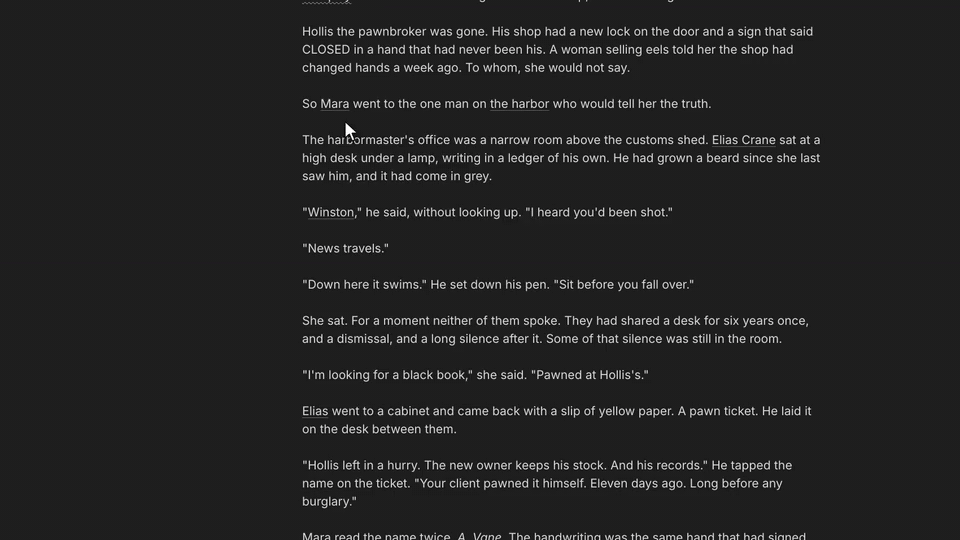
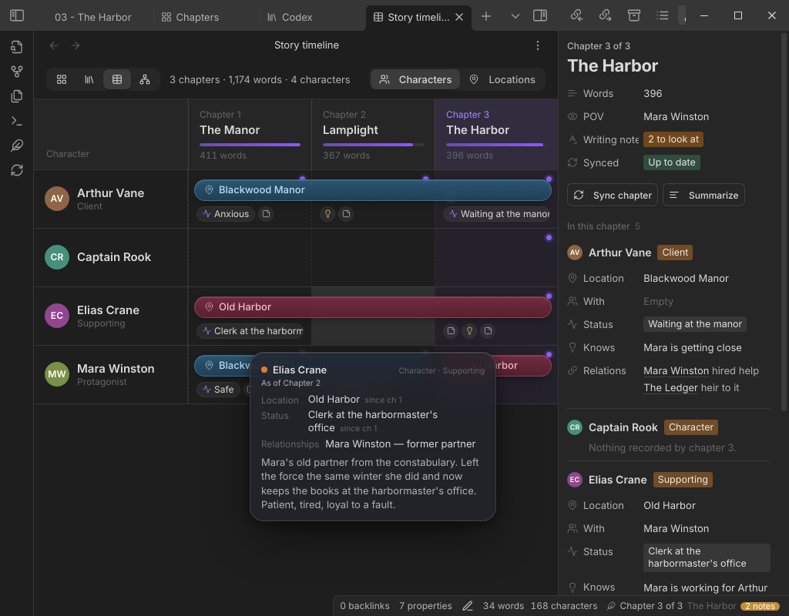
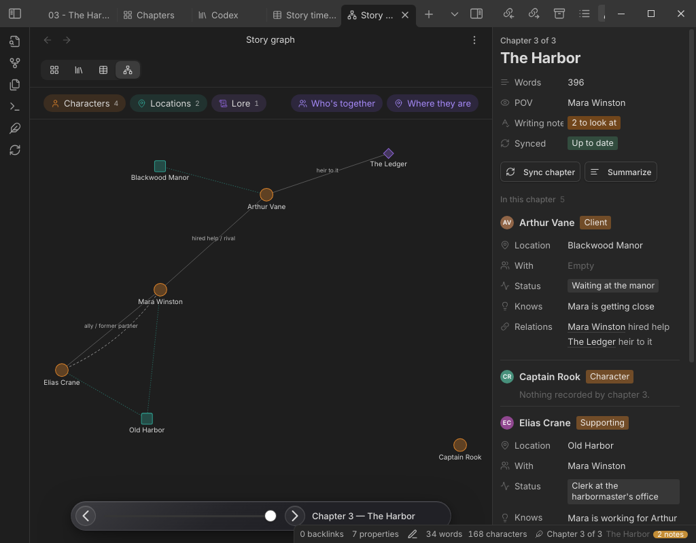
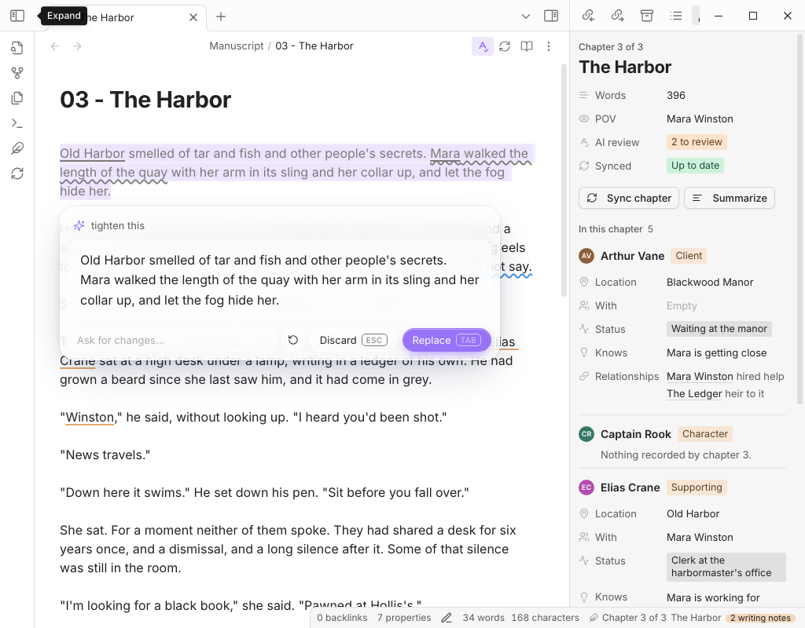

# Motif




You're on chapter 23. Where was Mara in chapter 9? Does Elias know about the ledger yet?

Motif is an Obsidian plugin for keeping track of a novel while you write it. When you finish a chapter, an AI reads it and writes down what changed for each character, like where they are now and what they've found out. Hover any name in the manuscript and you see that character as of the chapter you're in.

It also has a proofreader and some writing tools that work on the passage you select. Everything is plain Markdown in your vault, and you bring your own AI, local ones included.

## Try it in 2 minutes

The repo comes with a small sample book: a three-chapter detective story with the codex already filled in. You don't need an API key to look around.

1. Download the repo as a zip (or clone it).
2. In Obsidian, open the `My Book` folder as a vault and choose "Trust author and enable plugins".
3. Open `Manuscript/03 - The Harbor` and hover over "Mara".
4. Click the feather icon in the left ribbon to open the Timeline and the Graph. Drag the Graph's chapter slider back to chapter 1.

The plugin build is already in the sample vault, so you don't need Node for this. A setup guide opens the first time; you can skip it. Anything that calls an AI needs a provider, which you add in Settings → Motif.

## Install

With BRAT, which also keeps it updated:

1. Install BRAT from Settings → Community plugins → Browse, and enable it.
2. Run "BRAT: Add a beta plugin for testing" from the command palette and paste `codebyashton/motif`.
3. Enable Motif under Settings → Community plugins.

By hand: download `main.js`, `manifest.json` and `styles.css` from the [latest release](https://github.com/CodeByAshton/Motif/releases/latest), put them in `<your vault>/.obsidian/plugins/motif/`, and enable Motif.

Obsidian's community plugins directory: coming soon.

## What it does

Finish a chapter and click Sync chapter (the refresh icon in the chapter's header or the ribbon). Motif sends the chapter to your AI and adds the changes to your codex notes as timeline and relationship lines. If you rewrite the chapter and sync again, it replaces only the lines its last sync wrote. Lines you typed yourself are left alone.

Hovering a name shows that character as of the current chapter. The Cast panel shows the same for everyone in the chapter. The Timeline gives each character a lane across the chapters, and the Graph shows relationships, with a slider to watch them change.

Sync also runs an AI review of the chapter. It looks for typos, grammar, wrong-word mistakes (their/there, affect/effect) and run-on sentences, and underlines each one so you can fix or dismiss it. It doesn't comment on your plot.

To rewrite something, select it, press Cmd/Ctrl+K and type an instruction like "tighter". The new version streams in with a word diff. Tab keeps it and Esc throws it away.

The command palette has the rest: continue writing, rewrite, describe, brainstorm, critique, a continuity check, chapter summaries, a chat that knows your codex, and Markdown export.

| | |
|---|---|
|  |  |
|  |  |

## AI providers

Pick one in Settings → Motif.

| Provider | Notes |
|---|---|
| Claude Code | Uses your Claude subscription through the Claude Code app on your computer. No API key. |
| Anthropic | API key, pay per use. Book context is sent as a cached block to keep long books cheap. |
| OpenAI, OpenRouter | API key. |
| Ollama, LM Studio | Runs on your own machine. Free, and nothing leaves your computer. |
| OpenAI-compatible | Any other server with an OpenAI-style API. |

## Privacy

Motif has no telemetry or analytics. It only sends text when you use an AI feature, and only to the provider you picked:

- Anthropic: `api.anthropic.com`, with your API key.
- OpenAI and OpenRouter: `api.openai.com` or `openrouter.ai`, with your API key.
- Ollama and LM Studio: the local address in settings (`localhost` by default).
- OpenAI-compatible: the base URL you enter.
- Claude Code: Motif runs the `claude` program on your computer, and that program sends the request to Anthropic under your Claude account. Motif never reads or stores your Claude login. For each request it writes the book context to a temporary file in your system's temp folder and deletes it afterwards. To find `claude`, it may run your login shell once (`command -v claude`).

What gets sent is the passage or chapter you're working on, plus book context like codex entries and chapter summaries. Turn on "Show the prompt before sending" in settings to see every request before it goes out.

API keys are stored unencrypted in `.obsidian/plugins/motif/data.json` inside your vault, so don't sync or commit that file. Story assistant chats are only saved (to `.motif/chats/` in your vault) if you turn that setting on.

## Status and known limitations

This is 0.1.0, the first public release.

- Desktop only. The Claude Code provider needs Node, which Obsidian mobile doesn't have.
- Not in the community plugins directory yet. Use BRAT or install by hand.
- Sync and AI review are only as good as the model behind them. Small local models sometimes return something Motif can't read; it retries once and then shows an error.
- Sync edits your codex notes. It only replaces lines it wrote itself, but keep backups or use git, as with any plugin that writes to your files.
- On a long book, the context sent with each request is trimmed to fit a budget (Settings → Motif → Context budget), so older detail can drop out.
- Inside notes, Cmd/Ctrl+K opens Ask AI instead of Obsidian's "insert link". You can change or turn off the shortcut in settings.
- The automated end-to-end tests run against Obsidian on Linux. macOS and Windows have had much less testing.

## How your story is stored

Chapters are notes with a `chapter` number in their frontmatter. Characters, locations and lore are notes in a Codex folder, and each one keeps its history in two sections:

```markdown
## Relationships
- [[Arthur Vane]]: reluctant ally (ch 1-2)
- [[Arthur Vane]]: rival (ch 3+)

## Timeline
- ch 1 | location: [[Blackwood Manor]] | status: Safe | with: [[Arthur Vane]]
- ch 2 | status: Injured | note: shot in the left shoulder
- ch 3 | location: [[Old Harbor]] | knows: Arthur pawned the ledger himself
```

Each timeline line only changes the fields it lists, and `knows` adds up over time. Write `none` to clear a field. You can edit any of this by hand.

## FAQ

**Will it write my book for me?**
No, and that's on purpose. It's a co-pilot: it rewrites what you point at, keeps your story bible honest and catches your typos. The words are yours.

**What if the AI gets something wrong in the codex?**
Fix the chapter and sync again, or edit the codex note directly. Sync never overwrites lines you wrote.

**Can I use it for a series?**
Point the Codex folder setting at a folder the books share.

## Development

Needs Node 22.12 or newer.

```bash
npm install
npm run dev      # rebuild on change
npm run build    # type-check and bundle main.js
npm test         # unit tests
npm run vault    # build and copy into the sample vault in My Book/
```

The end-to-end tests drive a real Obsidian under a virtual display; see [e2e/README.md](e2e/README.md). The roadmap is in [ROADMAP.md](ROADMAP.md), and [CONTRIBUTING.md](CONTRIBUTING.md) has the basics for pull requests.

## License

[Apache-2.0](LICENSE)
